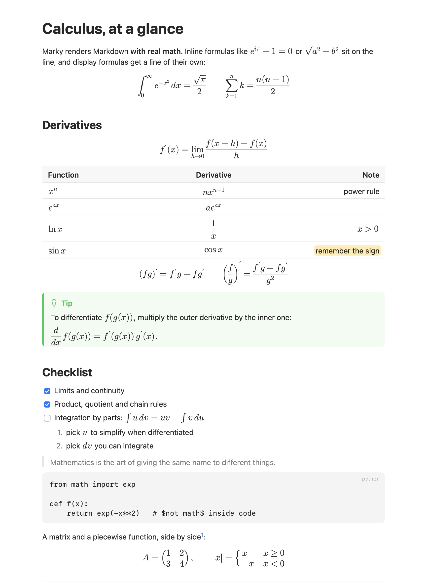
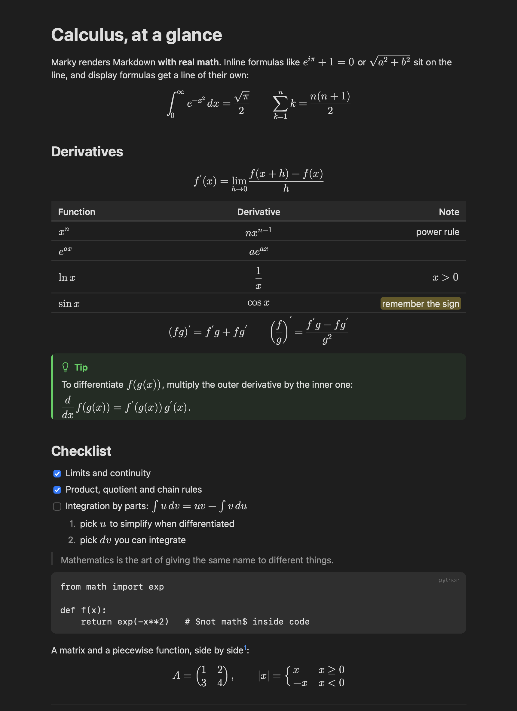

<p align="center"></p>

<h1 align="center">Marky</h1>

<p align="center"><b>A small, native Markdown reader for your Mac that typesets LaTeX math.</b><br>
Every math syntax people actually write, live reload as you save: 1.7 MB on disk, 30 to 45 MB of RAM.</p>

<p align="center">
  
  
</p>

## Why

Most Markdown previews either skip math or embed a whole web browser to draw it. Marky is a native
Swift and AppKit app that lays out text with the Mac's own text system and typesets every formula as
vector shapes, the way TeX would:

- **Every delimiter.** `$…$`, `$$…$$`, `\(…\)`, `\[…\]`, `` $`…`$ ``, ```` ```math ```` fences, and
  environments such as `\begin{align*}…\end{align*}` written straight into the text.
- **Real LaTeX.** Fractions, roots, sums and integrals with limits, matrices, `cases`, `align` with
  several columns, `\text`, `\operatorname`, `\xrightarrow`, colours, and your own macros
  (`\newcommand`, `\def`, `\DeclareMathOperator`). Unicode typed into a formula (`x₁`, `≤`, `α`)
  works too. A formula that can't be typeset is shown in red as written, instead of breaking the page.
- **Live reload.** Edit in Zed, VS Code, Vim or anything else: Marky shows each save at once and keeps
  your place, also for editors that save by replacing the file.
- **Light.** 1.7 MB on disk. A 36 KB file with 646 formulas opens in about 70 ms.

|                                                     | Marky          |
| --------------------------------------------------- | -------------- |
| App size on disk (download)                         | **1.7 MB** (1.0 MB) |
| Memory, a 36 KB file with 646 formulas open         | **≈ 33 MB**    |
| Memory, a page with links and colour, window in front | **≈ 45 MB**  |
| CPU while idle                                      | **0 %**        |

<sub>Measured with `footprint` (the number Activity Monitor shows) 10 seconds after opening, on an Apple
Silicon Mac running macOS 27, in an 800 × 900 window. macOS keeps a window that shows only shades of grey
in a quarter of the memory; once links or other colour are on screen, its buffers take about 16 MB more.</sub>

Marky is **free and open source** under the MIT License. It never connects to the internet, never
writes to your files, and has no accounts, telemetry or ads.

## What you get

- **Markdown as GitHub shows it:** headings, lists and task lists, tables with column alignment,
  block quotes, code blocks, footnotes, `> [!NOTE]` alerts, links, images, `==highlights==`,
  `[[wiki links]]`, YAML front matter and simple HTML.
- **Math that sits in the line.** Inline formulas share the text's baseline and size; display
  formulas are centred and shrink to fit narrow windows.
- **An outline** of the headings in a sidebar (View → Show Outline, ⌃⌘S) that follows your place
  as you scroll.
- **Find** (⌘F), **zoom** (⌘+ / ⌘− / ⌘0), **Print** and **Export as PDF**, tabs, full screen.
- **Copy keeps the LaTeX.** Copying a passage puts each formula on the clipboard as it was written,
  delimiters and all.
- **Links work:** `#headings` scroll within the file, relative links to other Markdown files open
  them in Marky, web links open in your browser.

The look is deliberately quiet: SF Pro text in a readable column, Latin Modern for math (the TeX
typeface), the system's own colours in light and dark mode, and colour only where it means something.
Remote images are not downloaded; Marky shows their description as a link instead.

## Install

Marky runs on Apple Silicon Macs with macOS 27 or later.

**Download:** grab `Marky.zip` from the [latest release](../../releases/latest), unzip it and move
`Marky.app` to Applications. The app is not notarized by Apple, so the first time you open it macOS will
ask you to confirm: open it once, then choose **Open Anyway** in System Settings → Privacy & Security.

**Or build it yourself** with Xcode or its command line tools (`xcode-select --install`):

```sh
git clone https://github.com/bhaskar0210s/marky.git
cd marky
make install    # builds Marky.app and copies it to /Applications
```

Open a file from Finder (right-click → Open With → Marky), drop it on Marky's Dock icon, or run
`open -a Marky notes.md`.

### Preview from your editor

Any editor that can run a command can open the current file in Marky. In Zed, for example, add a task
to `~/.config/zed/tasks.json`:

```json
[
  {
    "label": "Preview in Marky",
    "command": "open -a Marky \"$ZED_FILE\"",
    "reveal": "never",
    "hide": "always"
  }
]
```

and bind it in `~/.config/zed/keymap.json`:

```json
[
  {
    "context": "Editor && extension == md",
    "bindings": { "cmd-shift-v": ["task::Spawn", { "task_name": "Preview in Marky" }] }
  }
]
```

Put Marky's window beside the editor: every save shows up in it straight away.

## How it stays this small

- **No web view.** Text is laid out by AppKit's text system; formulas are typeset by
  [iosMath](https://github.com/kostub/iosMath) with the Latin Modern Math font and drawn as vector
  shapes, straight into the text.
- **Only what's on screen.** Layout runs for the part of the document in view, and a formula is
  typeset the first time it scrolls into view. Formulas typeset once are reused across reloads, so a
  save only typesets what changed.
- **No document machinery.** Marky opens files itself rather than through NSDocument, which keeps a
  private copy of the Launch Services database (5 to 13 MB) for the life of the app.
- **Shared, not repeated.** Paragraphs with the same layout share one style, repeated formulas share
  one attachment, and the parsed form of a file is thrown away once it is on screen.
- **Native all the way down.** Markdown is parsed by [md4c](https://github.com/mity/md4c), a fast
  CommonMark parser in C. Before that, a small scanner sets every formula aside so Markdown can't
  mangle its backslashes and underscores. No toolbar, no frameworks beyond the system's, link-time
  optimisation, and a window's memory is handed back as soon as it closes.

## Tested

- 130 unit checks of the scanner, the Markdown tree and the LaTeX rewriting, built with
  AddressSanitizer and UBSan, including random input.
- An end-to-end self-test that opens a file off screen, edits it the way editors save (atomic rename,
  in-place write, delete and recreate), checks that the view follows and keeps its place, zooms,
  shows the outline, exports a PDF and closes the window. It also runs under AddressSanitizer, UBSan
  and ThreadSanitizer.
- `leaks` with `MallocStackLogging` over the self-test: nothing from Marky. The only entries are three
  `NSXPCConnection` cycles that Apple's AppIntents framework creates in every AppKit app at launch.
- A 30-minute soak test on a 646-formula file (an edit every two seconds, scrolling, zooming, outline
  toggles, closing and reopening the window) levels off: after the first minutes typeset the whole file,
  memory stays between 68 and 75 MB to the end, apart from brief peaks while it zooms, and the live heap
  stays at about 25 MB. Left alone for 10 minutes, an open file stays at the same footprint, using no CPU.
- Edge cases: an empty file, binary data, Windows-1252 text, a 3.7 MB file with 50 000 formulas,
  20 000 unmatched `$` signs, 200 levels of nesting, and formulas nested thousands of braces deep.

## Development

```sh
make              # build/Marky.app
make run          # build and start it
make test         # unit tests, with AddressSanitizer and UBSan
make selftest     # end-to-end checks, off screen
make snapshot     # render docs/sample.md into docs/reader-{light,dark}.png
make icon         # redraw resources/Marky.icns from tools/icon.swift
make SANITIZE=address BUILD=build-asan   # a checked build (or SANITIZE=thread)
```

`build/Marky.app/Contents/MacOS/Marky --check FILE…` typesets every formula in some files and lists
the ones that fail, without opening a window.

`src/core` holds the formula scanner, the Markdown tree and the LaTeX rewriting (plain Swift),
`src/app` the AppKit app, and `vendor` md4c and iosMath. Pushing a tag such as `v1.0.1` builds the
app on GitHub and publishes it as a release.

## Credits

Markdown parsing by [md4c](https://github.com/mity/md4c) (MIT License). Math typesetting by
[iosMath](https://github.com/kostub/iosMath) (MIT License), with a few changes listed in
[THIRD-PARTY-NOTICES](THIRD-PARTY-NOTICES). Formulas are set in Latin Modern Math by B. Jackowski,
P. Strzelczyk and P. Pianowski (GUST Font License). Marky is an independent app with its own design
and code.

## License

[MIT](LICENSE)
